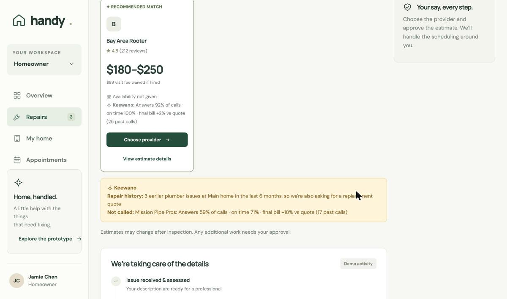
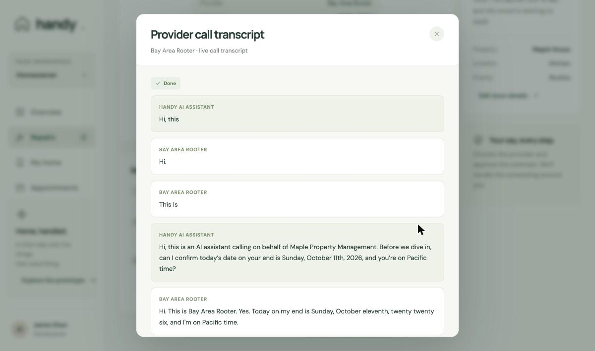
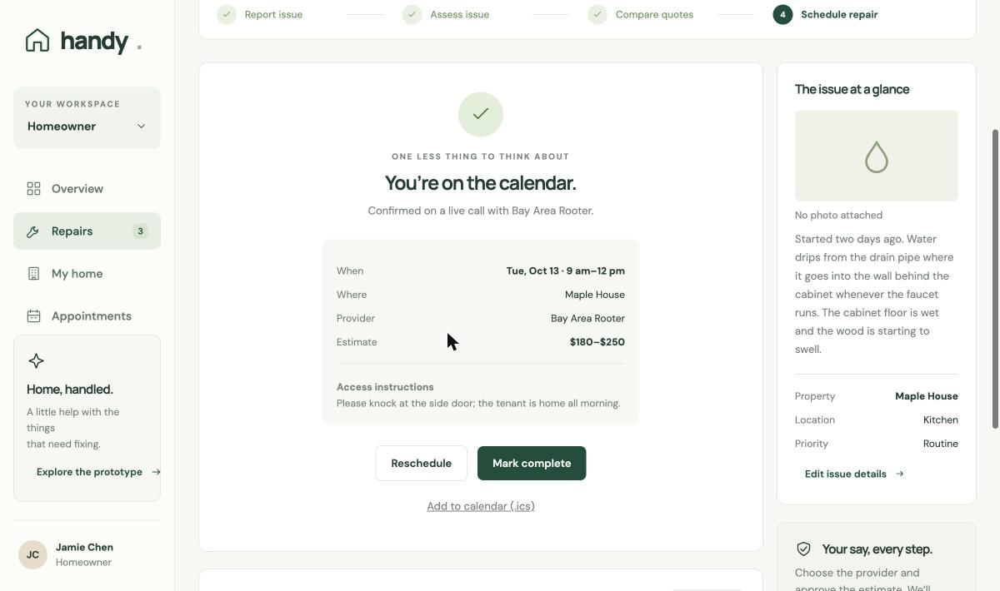

# Handy — snap a photo, get it fixed

**Handy turns a photo of a home-repair problem into a booked appointment.** Claude diagnoses the photo, Keewano picks which providers are worth calling, AI voice agents (Dial) call them for quotes, and once you approve one, Handy calls back to book it.

Built in one day at SpeedHacks (a16z speedrun × SF Tech Week, 2026-10-11).

## Verified live on 2026-10-11

One run through the web UI (`public/index.html`) with every mock flag off:

1. **Claude Opus 5.5** diagnosed "Drain leak at wall connection under kitchen sink" (plumber, $150–450 estimate).
2. **Keewano** ranked the verified plumbers from their call history: Bay Area Rooter **96** was called; Mission Pipe Pros **64** (answers 59% of calls, final bills +18%) was skipped, and the UI says why.
3. **Dial** placed a real AI quote call to our AI-receptionist number, which plays the fictional Bay Area Rooter.
4. **Claude Sonnet 5.5** extracted **$180–$250 flat, $89 visit fee waived if hired** from the transcript, checked against the provider's own words. The call hit its 240 s cap before openings came up, so availability was marked *not given* rather than guessed.
5. After an explicit approval of that exact quote, **Dial** placed the booking call; the provider confirmed **Tue Oct 13, 9 AM–12 PM**, terms unchanged, and the appointment exported to `.ics`.

Providers and their history are fictional and seeded, and labeled as such. No real business was called.

| Keewano decides who gets called | Dial's real booking call | Booked on a live call |
|---|---|---|
|  |  |  |
| Rooter's reliability record, the unit's repeat-plumbing history (adds a replacement-quote question), and why Mission Pipe Pros was skipped | The agent discloses it is an AI, restates the exact approved quote, and books only a window you offered | The provider confirmed one of the offered windows; export to calendar with `.ics` |

## The problem

When something breaks at home, the repair itself is rarely the slow part. Finding and coordinating the pro is:

- **56% of respondents** in Modernize's **2021 home-improvement survey** spent **1–5 hours** researching before requesting a quote. ArcSite's **2022 report** found **95% seek multiple bids**, with a majority often seeking **3 or more**. These are historical survey findings, not measurements of every small repair ([Modernize / QuinStreet](https://investor.quinstreet.com/node/16861/pdf), [ArcSite](https://www.arcsite.com/blog/2022-homeowner-survey-report)).
- Property managers repeat that coordination across units and may also travel to inspect reported issues. We have not established a research-backed weekly workload or commuting-hours benchmark for this group.
- Every quote means calling, waiting, repeating the same description, phone tag, then calling back to schedule.

**Our manual-coordination model (an estimate, not a measurement):** about 30 min of research, plus 3 providers × (3 min to find the number + 8 min on the call + 10 min of phone tag), plus 15 min of scheduling = **108 minutes** of hands-on time per repair. These are assumed inputs, separate from the surveys above. Handy aims to reduce the user's hands-on work to a photo, a review and one approval. The backend stores each request's active time (`userActiveSec`) and Keewano tracks minutes-to-book. The UI timer that feeds them is still to come; actual Handy time savings have not yet been measured.

## How it works

```
photo + description
   │
   ▼
Claude (Opus 5.5 vision)  ──► diagnosis, trade, urgency, cost range, provider brief (+ DIY plan when safe)
   │   emergencies (gas, fire, sparks, flooding) stop here with safety guidance
   ▼
Keewano  ──► ranks providers from event history (answer rate, on-time rate, final bill vs quote)
   │        and checks the unit's repair history ("3rd plumbing issue → also ask for a replacement quote")
   ▼
Dial  ──► AI voice agents call the top-ranked providers (up to 2 at once); each discloses it is an AI and never commits
   │
   ▼
Claude  ──► transcript → structured quote (price, fee treatment, availability, scope, evidence)
   │
   ▼
You compare and explicitly approve  ──► Dial booking call ──► scheduled + calendar invite (.ics)
```

## What's real vs simulated (status at submission)

| Piece | Status |
|---|---|
| Photo diagnosis + DIY plan | **Real.** Claude Opus 5.5 vision with schema-validated structured output (`lib/claude.ts`) |
| Part search | **Real.** Claude web search returns the 3 best purchase options with verified product links, for DIY fixes and for parts a pro will need (`lib/parts.ts`) |
| Provider ranking + unit history | **Real queries** against Keewano. The provider/unit history behind them is **seeded and labeled** (`DataSource=seed`) |
| Dial voice calls | **Real, verified live end to end on the backend:** a quote call (with the photo delivered by MMS), then a booking call through the real `/book` and polling endpoints, confirmed by a controlled provider ([`eng-design/dial-endpoint-handoff.md`](eng-design/dial-endpoint-handoff.md)). Idempotency keys, speaker-separated transcripts, and smoke tests (`npm run smoke:dial`, `npm run smoke:booking`). Parallel live calls are untested, so the live demo uses `QUOTE_FANOUT=1` |
| Photo packets to providers | Backend routes (`packet`, `share-packet`, `messages`) with idempotency and a recipient allowlist. One live photo MMS delivered to a controlled Dial number; live sends are limited to allowlisted numbers |
| Transcript → quote/booking extraction | **Real.** Claude Sonnet 5.5 turns transcripts into schema-validated quotes and booking confirmations, checked against the provider's own words (`lib/evidence.ts`). Mock mode uses fixtures |
| Providers | **Simulated.** The names are fictional, and their phone numbers are teammates' phones and our own AI-receptionist Dial number. We never call real businesses with fake jobs |
| Web UI | Vanilla-JS app (`public/index.html`) served by Next.js. **API-backed requests now use diagnosis, part search, outreach, quotes, exact-quote approval, booking, and transcripts.** Built-in samples remain simulated; mock flags govern backend behavior. **Verified live end to end on 2026-10-11** (see [above](#verified-live-on-2026-10-11)) |
| Calendar export | **Real.** `.ics` uses the confirmed slot's explicit date and its own start and end ("Tue, Oct 13 · 9 am–12 pm" → 09:00–12:00) in the property's local time. Times are floating (no time-zone ID yet) |
| Look B app (homeowner and manager) | `public/app/` with its own server (`server/`, port 4173). **Live mode** (`npm run app:live` next to `npm run dev`): repairs on Maple House, Oak Street and Cedar Cottage run the real flow through the backend above (Claude diagnosis, Keewano ranking, Dial quote and booking calls, the same approval gate), verified end to end on 2026-10-11. Houses added in Settings and the seeded sample repairs stay simulated and are labeled "Demo". Changing the time of a live booking isn’t supported yet. **Demo mode** (`npm run app:demo`): scripted calls only |

Anything simulated or seeded is labeled in the app and in the demo video.

## Partner tools

| Partner | How Handy uses it | Why it matters |
|---|---|---|
| **Dial** | Outbound AI quote calls with AI disclosure, booking calls only after approval, an inbound AI-receptionist persona, idempotent call placement, speaker-separated transcripts, and repair photo packets to Dial-to-Dial recipients | It is the core action: Handy makes the phone calls so you don't have to |
| **Keewano** | Typed, append-only event registry (`lib/keewano.ts`); SQL over the Postgres protocol decides **who gets called** and **what to ask**; before/after metrics; live Q&A over MCP | **Load-bearing:** a 4.4★ provider who answers only 59% of calls gets skipped; a unit's repair history adds a replacement-quote question. Example questions: [`docs/keewano-qa.md`](docs/keewano-qa.md) |
| **Sparta Worlds** | [`sparta/`](sparta/README.md): a deposit-settlement agent that refunds a held deposit **exactly once** when a provider cancels, graded in Sparta's local Stripe copy under an injected HTTP 500 | The naive agent passes **3/6** runs; the fixed one (retry, stable idempotency key, verify after write) passes **6/6**. It runs after booking and isn't wired into the app yet |
| **Alike** | Team coordination for our coding agents (3 of 4 teammates; it needs macOS): shared decisions anchored to contract files, briefings at session start | Shared decisions and context support work across sessions |

## Safety and trust

- **You approve every commitment.** No booking call goes out without a recorded approval tied to a specific quote (`Approval.quoteCallId`). An inspection-only offer approves the visit fee, never an invented repair total.
- **Unknown is not zero.** A missing price stays `null`, and "$89 fee waived if hired" is not an extra $89 (`feeTreatment`).
- **Calls are honest and bounded.** Every call opens with an AI disclosure. Quote calls never book, commit or share the exact address. Placing a call is idempotent and never auto-retried blindly.
- **Emergencies exit the flow.** A deterministic keyword gate runs regardless of the model's label.
- **No secrets in the repo.** Keys stay in `.env.local` and teammates' numbers in `data/providers.local.json` (both gitignored). Agents are denied reading them (`.claude/settings.json`).

## Run it

There is no hosted backend: everything runs locally and binds to 127.0.0.1. See the [live endpoint handoff](eng-design/dial-endpoint-handoff.md) for configuration and controlled-call validation.

```bash
npm install
# npm run dev creates .env.local from .env.example on first run: every MOCK_* = 1, no keys needed (fake calls finish in ~16 s)
# for real Claude diagnosis: set ANTHROPIC_API_KEY and MOCK_CLAUDE=0 in .env.local
npm run dev                  # http://127.0.0.1:3000
npm test                     # vitest
npm run typecheck
```

To go live, flip each `MOCK_*` flag to `0` as you add its keys (see `.env.example`):

| Command | What it does |
|---|---|
| `npm run preflight` | Pre-demo check, no calls placed: mock flags, keys, call limits, verified providers, who Keewano would call, Dial numbers, Claude models, app running. Prints no keys or numbers |
| `npm run seed:keewano` | Loads the labeled seed history |
| `npm run try:diagnose` | Tests Claude diagnosis on its own |
| `npm run smoke:dial` | A controlled live Dial quote call |
| `npm run smoke:booking` | A controlled live booking call |
| `npm run setup:receptionist` | Gives the second Dial number the fictional "Bay Area Rooter" receptionist persona |

For the live demo we set `QUOTE_FANOUT=1` (Dial's free tier allows 2 concurrent calls) and map the demo providers to our own Dial numbers in `data/providers.local.json` (gitignored; see `data/providers.local.example.json`).

Look B app: `npm run app:live` (with `npm run dev` running) or `npm run app:demo` (scripted, no keys), then open http://127.0.0.1:4173/app/.

API: `POST /api/requests` → `POST /api/requests/:id/outreach` → poll `GET /api/requests/:id` → `POST /api/requests/:id/book` → `GET /api/requests/:id/ics`. Also `GET /api/providers` and `GET /api/metrics`.

## Repository map

| Path | What's there |
|---|---|
| `public/index.html` | Web UI (live backend) |
| `public/app/`, `server/` | Look B app and its server; `server/integrations/live.js` connects it to the live backend |
| `public/proto/`, `docs/design/` | Clickable design prototype, design system, screens and sketches |
| `app/api/` | Next.js 16 route handlers |
| `lib/orchestrator.ts` | Call lifecycle: concurrency cap, per-request locking, extraction retries, status machine |
| `lib/claude.ts`, `lib/parts.ts` | Diagnosis and DIY part search |
| `lib/dial.ts`, `lib/instructions.ts`, `lib/communications/` | Calls, call scripts, photo packets |
| `lib/keewano.ts`, `scripts/seed-keewano.ts` | Event registry, queries, seed |
| `lib/types.ts`, `lib/schemas.ts`, `lib/evidence.ts` | Shared contracts and evidence checks |
| `sparta/` | Sparta Worlds deposit-settlement agent and evidence |
| `prototypes/dial-contract/` | Live Dial contract experiment |
| `docs/`, `eng-design/`, `PRD.md` | Spec, engineering designs, product requirements |
| `CLAUDE.md` | Shared conventions for every teammate's coding agent |

## Market and path forward

- **Who we start with:** property managers with 50–500 units. They coordinate repairs every day, repeat the same calls for every unit, and already pay for software.
- **Revenue:** a per-unit SaaS fee for managers, plus a small fee on each booked job.
- **Supply side:** pros get a free AI receptionist (Dial inbound) that answers Handy's quote calls and their own missed calls. That gives them a reason to join, and it turns the business into a two-sided marketplace.
- **Moat:** every call, quote and visit becomes Keewano history (who answers, who shows up on time, who bills what they quoted), so each repair makes the next match better.
- **Then:** homeowners, with the same flow and a consumer price.

## What's next

- Run several providers’ quote calls in parallel live (so far tested in simulation only), and support changing the time of a live booking.
- Real provider discovery through directory APIs, with verified contacts and service areas. The demo currently uses labeled seeded providers ranked by Keewano.
- Normalized availability windows (start/end plus time zone) end to end, so bookings and calendar invites never depend on phrases like "Tuesday afternoon".
- Payments: the Sparta-tested deposit agent becomes the post-booking money step.

## Team

[@alvinwang922](https://github.com/alvinwang922) · [@rwberndt](https://github.com/rwberndt) · [@hjun-escape](https://github.com/hjun-escape) · [@FrancescoRosciano](https://github.com/FrancescoRosciano). We built with Claude Code and coordinated our agents through Alike.
