# Handy design: Look B, "a text from a friend"

Handy is for people who are not technical. Each repair is a chat thread with Handy, a helper who sends photos, prices and confirmations the way a friend would text them. The working app is `public/app/` (PR #9). The clickable prototype and its flow map are `public/proto/review.html`.

## How we got here

1. **Directions.** Three looks, each across three phone screens: A "estimate slip" (paper receipt), B "a text from a friend" (chat), C "aisle sign" (hardware-store signage). See `sketches/look-directions.html` and the revised `sketches/look-directions-v2.html`.
2. **Upload flow in look A.** See `sketches/a-upload-flow.html`.
3. **Look B chosen.** A chat is the one interface everyone already knows; it carries progress, prices and approvals without new UI to learn.
4. **Clickable prototype.** 32 screens and states, with a flow map and screen index (`public/proto/review.html`).
5. **Webapp, then a UI/UX review.** The review changes are below and are built into `public/app/`.

## UI/UX review (applied)

**Round 1**

| Review point | What changed |
|---|---|
| Make optional fields obvious; remove useless ones (the room doesn't matter) | The report form asks only "What's happening?" (required). Room and urgency questions are gone; the app sends defaults. |
| Remove "How soon does it need fixing?" | Removed. |
| Fully autonomous after Send, straight to the prices with pros and cons and one recommended | After Send, Handy creates the repair, calls pros and shows every option with plain-word pros and cons. One option is marked "Recommended" with a one-line reason. No taps in between. |
| Remove "Extra work needs my OK first." | The consent line is "I approve this pro and this provisional price." |
| "Yes, approve" must finish everything | "Yes, approve and book $X" approves and books in one tap (see round 2 for picking times). |
| Big focus on the dashboard; two versions, homeowner and property manager | Two apps with a chooser at `/app/`: `owner.html` and `manager.html`, each with its own dashboard (below). |

**Round 2**

| Review point | What changed |
|---|---|
| Remove "Say which room it's in. Mention any smell of gas, sparks or flooding." | Removed. |
| Remove the "Name it" field | Removed; the list title comes from the description. |
| A dropdown of all the houses instead of a single house, with a way to add a house in settings | "Which house?" dropdown in both apps with an "Add a house" link. A Settings page lists houses and adds new ones (saved on the server). Homeowners see their own homes; managers see every property. |
| Three columns with side-by-side comparison | The prices are three equal columns with aligned rows: price, rating, when they can come, guarantee, pros, cons, button. The recommended column is outlined. On phones the columns swipe. |
| Choose availability as 2-hour time slots | The approval sheet asks "When are you free?" with 2-hour slots by day (8–10, 10–12, 12–2, 2–4, 4–6 over three days). Pick up to 6; Handy books the first one the pro can do. |
| "Get new prices" should continue as a new sent message | The earlier prices stay in the chat. "Get new prices" appears as the user's message, Handy calls again, and the fresh comparison follows. |

Approval stays explicit: nothing is booked until the user picks a time, ticks consent and taps yes, and an approval record is written first (PRD principle 1).

## Two apps

**Homeowner (`owner.html`).** A dashboard for your homes: a greeting with a one-line status and your houses, a large "Report a problem" panel, "Happening now" cards grouped by house (each shows its step on a Guess → Prices → Booked tracker, the key fact and one next action), "Coming up" visits with "Add to calendar", "Done", and money spent this year.

**Property manager (`manager.html`).** A portfolio dashboard:
- "Needs you": items waiting for a decision, each with one action; hazards in red.
- One block per property: address, unit, tenant, open/booked/fixed counts, its repairs, "Report a problem here"; "Add a property".
- This week's visits, spend per property (bar chart), and a funnel from reported to booked, plus a full Insights view.

Both apps have a Settings page for houses, reachable from the side menu and the dashboard header.

## Screens

| | |
|---|---|
| 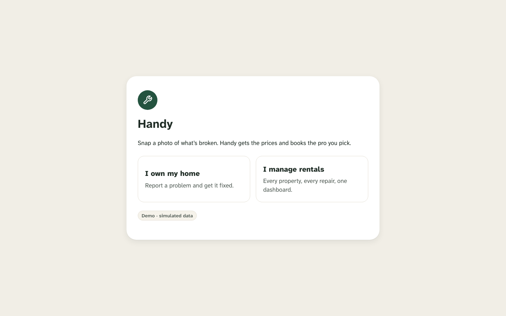 | 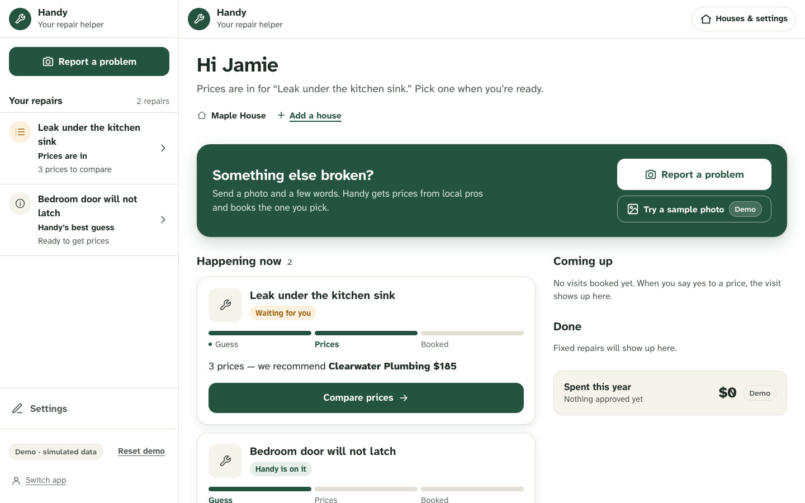 |
| 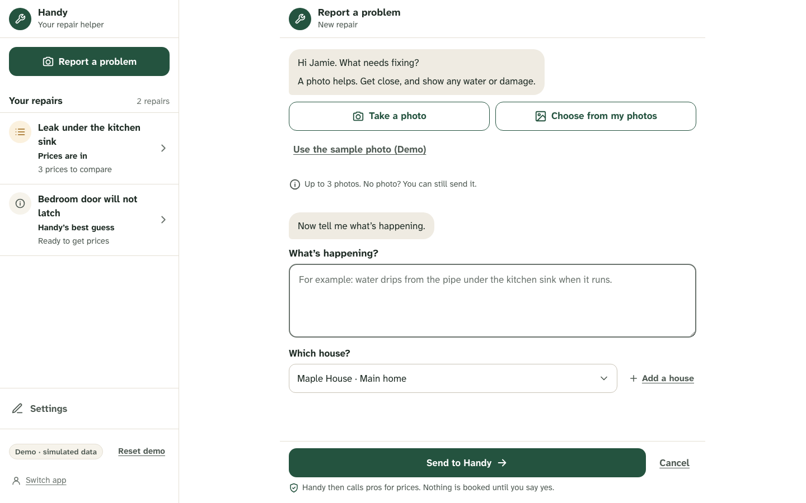 | 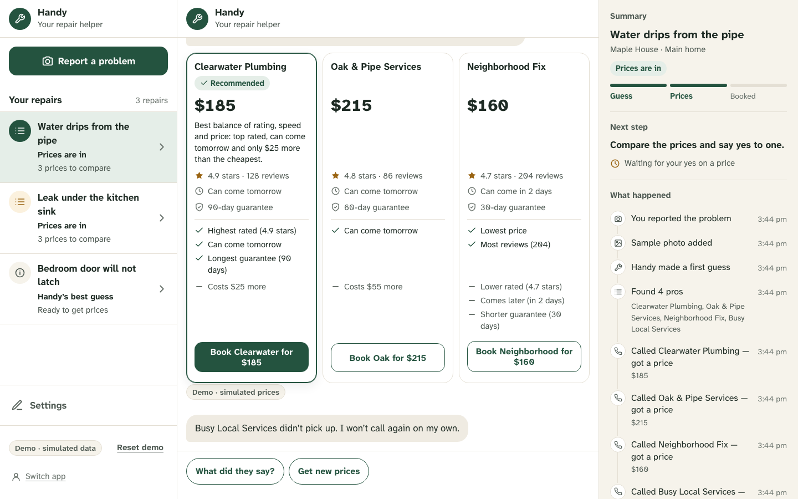 |
| 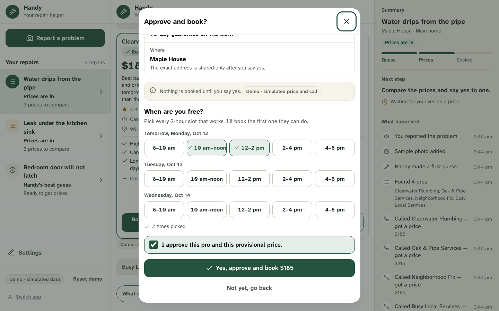 | 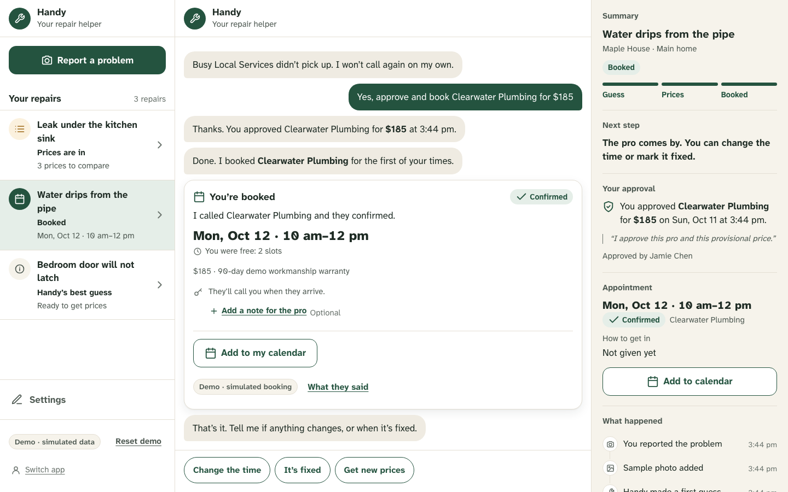 |
| 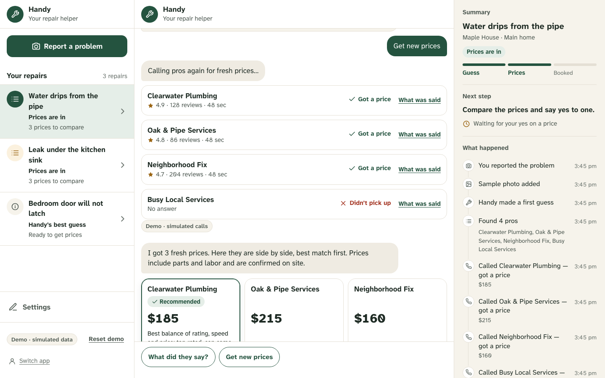 | 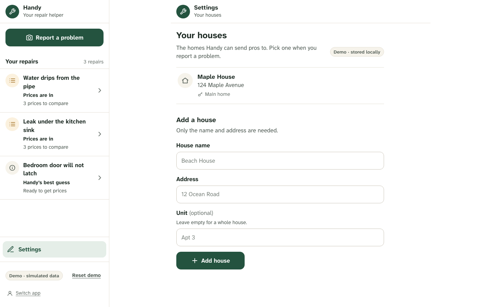 |
| 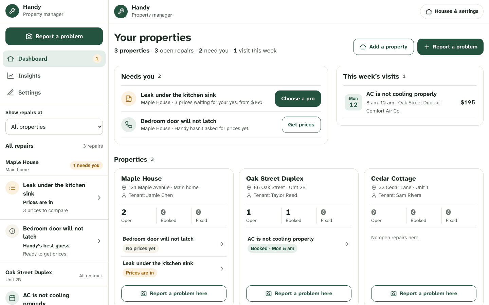 | 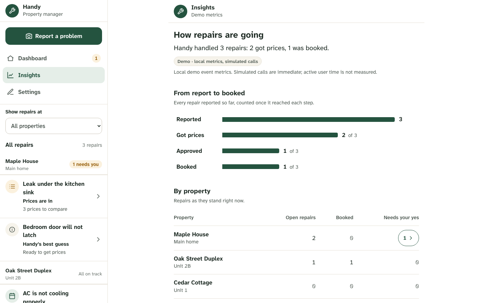 |
| 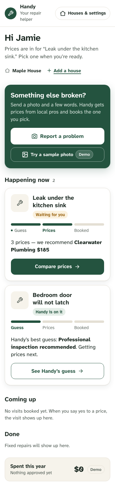 | 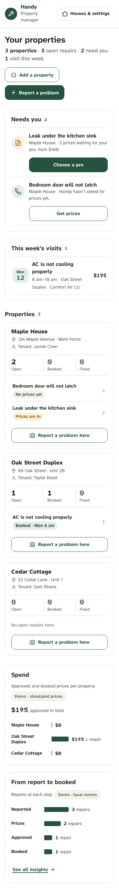 |

## Visual system

### Color roles

| Token | Value | Role |
|---|---|---|
| `--ink` | `#1E2B24` | Text |
| `--ink2` | `#4F5A53` | Secondary text, optional-field labels |
| `--ink3` | `#6A736D` | Hints, timestamps |
| `--green` | `#24533F` | Primary actions, user bubbles, progress |
| `--green-press` | `#1B4131` | Primary hover/pressed |
| `--green-tint` | `#E5EEE8` | Selected chips, "Recommended" and "Confirmed" tags |
| `--bubble` | `#EFEBE2` | Handy's chat bubbles |
| `--pinned` | `#F6F3EB` | Status card, details panel, notes |
| `--line` | `#E4DFD4` | Borders and dividers |
| `--stage` | `#F1EEE6` | Page background behind panels |
| `--amber` / `--amber-tint` | `#9A6412` / `#FBF1DE` | "Waiting for you", warnings, star ratings |
| `--red` / `--red-tint` | `#A2311F` / `#FBE9E5` | Danger only: emergencies, Call 911 |

Red is reserved for danger. Ordinary errors use amber or plain text.

### Type

Atkinson Hyperlegible Next for everything (designed for low-vision readers). Body 17px, nothing below 15px. Page titles 26px, dashboard titles up to 34px, prices 30px/800 with tabular numerals.

### Shape and depth

Chat bubbles radius 20 with a 6px "tail" corner (bottom-left for Handy, bottom-right for the user). Cards radius 18, 1px `--line` border, soft shadow `0 6px 18px rgba(30,43,36,.08)`. Pills fully rounded. No nested cards.

### Controls

- Buttons at least 52px tall (primary green; ghost green outline; plain underlined text for secondary).
- Quick-reply chips 48px, outlined green, filled when pressed.
- Inputs 52px with 1.5px border; optional fields are visibly quieter than required ones.
- Visible 3px green focus ring on every control.

### Layout

- Desktop (≥1024px): three panes (repairs list 320px · chat · details 360px). Dashboards use the full width.
- Tablet (640–1023px): list + chat, details below.
- Phone (<640px): one pane at a time; the dashboard is the home screen.

### Components

Pinned status card with a 3-step tracker; Handy and user bubbles; typing dots; live call rows (Waiting → Ringing → Talking → Got a price / Didn't pick up); three-column price comparison with aligned pros/cons and a Recommended column; approval sheet that repeats everything back and asks for 2-hour slots; booked card with "Add to my calendar" (.ics); activity timeline.

### Words

Plain words: "pro" or "plumber", not "provider"; "price", not "estimate"; confidence as words, never a percentage. Every simulated thing carries a "Demo" label. Every call discloses that it is made by an AI assistant.

### Icons and motion

Authored inline SVG icons at one stroke weight; no emoji. Motion only shows real progress (typing dots, call bars) and stops under `prefers-reduced-motion`.

## Not allowed

Eyebrow or kicker labels above headings, gradient text, decorative glass, colored left borders on cards, hard offset shadows, monospace as decoration, nested cards, emoji icons.
