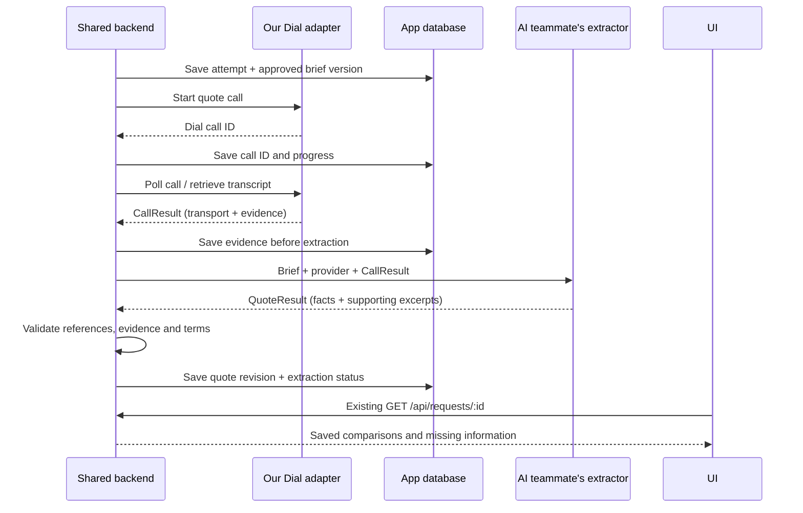

# Dial call results: shared backend and database proposal

**Status:** Proposed contract, October 11, 2026. Validated in part by the [isolated live-call prototype](../prototypes/dial-contract/README.md); not a database migration or app integration.

The Dial integration returns results to **Handy's backend/orchestrator**. The backend stores the call evidence, invokes the AI teammate's extractor, validates its answer, and stores a structured quote. The UI reads the saved request. The assessment agent does not need to stay running while providers answer, and the voice agent does not write directly to the database.



## Ownership

| Owner | Produces / owns |
| --- | --- |
| Us: discovery and Dial | Eligible provider target; call dispatch, polling, speaker-separated transcript and transport errors. Discovery supplies verified contact and service-area eligibility; diagnosis alone does not. |
| AI teammate | Repair assessment before outreach; structured quote extraction after outreach, including unknowns and evidence. This is an explicit proposed ownership agreement. |
| Shared backend / DB teammate | Persist attempts before calling, join records, invoke extraction, validate results, deduplicate updates, manage revisions and expose request results. The schema owner chooses physical tables/columns. |
| UI teammate | Display saved estimates, fees, conditions, partial results and availability; collect approval against a specific quote revision. |

For the current single Next.js app, use typed function calls and the existing `lib/orchestrator.ts` flow. No new public callback endpoint or separate microservice is required. If Dial webhooks are added later, they update the same backend records; they do not bypass extraction or validation.

## 1. CallResult — what our service sends back

Extend the existing `CallRecord`; preserve its current names and state values. These are logical fields, not a demand for a new table:

| Field | Meaning |
| --- | --- |
| `schemaVersion: 1` | Contract version. |
| `callRecordId`, `requestId`, `providerId` | Handy's local IDs; allocate the call record before contacting Dial. |
| `briefVersion`, `briefHash` | Immutable input actually used for this call. The prototype hash includes the provider and purpose as well as the brief. Map `briefVersion` to the team's repair-packet version rather than inventing two competing versions. |
| `purpose: "quote" \| "booking"` | Keep quote collection and approved scheduling separate. |
| `dialCallId: string \| null` | External ID; null until acknowledged. |
| `dispatchState` | `queued`, `dispatching`, `accepted`, `send_unknown`, or `failed`. An uncertain POST response must not automatically cause another call. |
| `state`, `terminationType` | Existing Dial transport fields. A completed call is not proof of a quote or booking. |
| `startedAt`, `endedAt`, `durationSec` | Known timestamps/duration, otherwise null. |
| `transcriptStatus` | `pending`, `ready`, or `unavailable`; may become ready after the call ends. |
| `transcript`, `transcriptTurns[]` | Raw text and `{speaker, text, startMs, endMs}`. On an outbound call, Dial's `user` speaker is the provider. |
| `transcriptHash` | Identify the specific evidence version consumed by extraction. |
| `error` | Safe structured stage/code/message; preserve existing display text if needed. Never include credentials. |

Persist transport results even for busy, unanswered or failed calls. Such results must not create an empty or zero-dollar quote. Keep an extraction state separately: `not_started`, `pending`, `validated`, or `failed`, with attempt count and a safe error. Retrying extraction uses the saved evidence and never redials.

## 2. QuoteResult — what the extractor returns

Reuse `Quote` from `lib/types.ts` and the executable [prototype schema](../prototypes/dial-contract/contract.ts). Preserve USD units and nullable values. The prototype already validates these additions:

| Field | Meaning |
| --- | --- |
| `requestId`, `providerId`, `briefVersion`, `dialCallId` | Correlate the quote to the exact repair, provider and conversation. |
| `extractionMethod` | `model`, `assistant_review`, or `human_review`; do not represent reviewed prototype output as autonomous extraction. |
| `outcome` | `quote_received`, `inspection_only`, `needs_information`, or `declined`. |
| `collectionStatus`, `uncollectedFields[]` | `complete` or `partial`, and what the conversation did not establish, such as availability. |
| `quote` | Existing price low/high, pricing type, visit fee, availability, inspection flag, scope, warranty, conditions, notes and confidence. |
| `feeTreatment` | `none`, `additional`, `included`, `waived_if_hired`, or `unknown`. A conditional waiver is not an extra charge. |
| `missingInformation[]` | Information the provider requested, such as pipe material or a close-up photo. Distinct from fields our agent failed to collect. |
| `quoteBasis` | Prototype: `description_only` or `inspection_required`; add `photos_and_call` only with actual photo-review evidence. |
| `photoReviewState` | Prototype always `not_reviewed`; the app's packet/message work can support the richer review states in the main design. |
| `evidence[]` | `{field, providerText}` exact provider excerpts supporting the extracted terms. Caller suggestions cannot establish a price. |

The DB owner should add **`quoteId`, `revision`, `createdAt`, `extractorVersion`, and source references** when persisting. Source references should identify the call/transcript version and evidence turn; later SMS evidence can identify a message ID. The prototype's exact excerpts are a starting point, not a replacement for durable source references or semantic review.

Keep the existing `availability: string[]` for compatibility. Before scheduling, add normalized windows with start/end timestamps and the property's IANA timezone; a string such as “Tuesday afternoon” cannot establish a confirmed booking. The brief must include timezone and a reference date for relative expressions.

### Example: the actual partial-result shape from the live test

```json
{
  "requestId": "req_example",
  "providerId": "provider_b",
  "briefVersion": "brief_1",
  "dialCallId": "call_example",
  "extractionMethod": "assistant_review",
  "outcome": "quote_received",
  "collectionStatus": "partial",
  "uncollectedFields": ["availability"],
  "quote": {
    "priceLowUsd": 180,
    "priceHighUsd": 280,
    "pricingType": "flat",
    "visitFeeUsd": 89,
    "availability": [],
    "needsInspection": true,
    "scope": "Standard sink drain repair including labor and standard fittings",
    "warranty": "30-day workmanship warranty",
    "conditions": "Visit fee waived if repair proceeds; estimate provisional until inspection",
    "notes": "Call ended before availability was collected",
    "confidence": 0.9
  },
  "feeTreatment": "waived_if_hired",
  "missingInformation": ["Existing drain pipe material"],
  "quoteBasis": "description_only",
  "photoReviewState": "not_reviewed",
  "evidence": [
    {"field": "price", "providerText": "flat repair price estimate, one hundred and eighty to two hundred and eighty dollars."},
    {"field": "fee", "providerText": "Diagnostic visit fee, eighty nine dollars if they decline the repair. Waived if they proceed with the repair."},
    {"field": "conditions", "providerText": "Diagnostic visit fee, eighty nine dollars if they decline the repair. Waived if they proceed with the repair."},
    {"field": "scope", "providerText": "Labor plus standard drain fittings included."},
    {"field": "warranty", "providerText": "Workmanship warranty, thirty days."},
    {"field": "missingInformation", "providerText": "Do you know if the existing drain piping under the sink is mostly PVC plastic?"}
  ]
}
```

IDs are illustrative; terms and excerpts came from a real call with a fictional provider persona. This is a provisional $180–$280 repair estimate, not $269–$369 and not a scheduled appointment.

## 3. Suggested database relationships and update rules

`RepairRequest 1 → many CallAttempts`, `Provider 1 → many CallAttempts`, `CallAttempt 1 → many QuoteRevisions`. A quote revision can reference additional messages when SMS is integrated. The schema owner can use tables or embedded records; for now these can remain additive fields on `RepairRequest.calls[]` and its quote data.

- Make non-null `dialCallId` unique. Link through Handy's local call ID when dispatch acknowledgment is uncertain.
- Save raw evidence before extraction. Deduplicate extraction by call ID + transcript hash + extractor version; refreshing a request must not create duplicate quotes.
- Preserve quote revisions. A new assessment or changed terms cannot silently overwrite the version approved by the user.
- Keep null as unknown and zero as explicitly free. An inspection-only result has null repair prices even when its visit fee is known.
- Preserve partial results. Unanswered availability stays empty; never copy a slot from a persona fixture or another provider.
- Store transcripts privately and return a suitable UI projection through the existing request API. Keep communication evidence in the app database; Keewano's registered analytics events are a separate concern unless the DB owner explicitly chooses it for operational storage.
- Scheduling consumes an explicit approval tied to `quoteId`/revision and permitted windows. Quote success alone must never dispatch a booking call.

**Next integration step:** agree on these logical fields with the DB and AI owners, then update `lib/types.ts`, matching Zod schemas and the existing orchestrator together. The prototype deliberately leaves those shared files unchanged.
