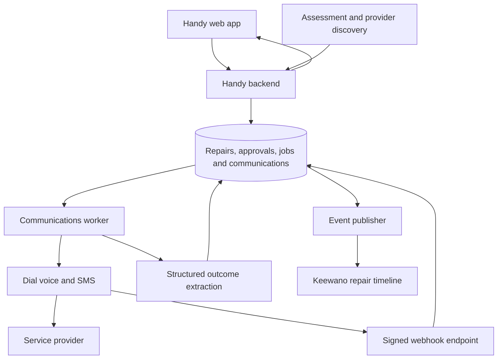

# Handy Dial engineering design

**Status:** Proposed hackathon implementation · October 11, 2026

**Scope:** SMS and voice agents for provider quotes and appointment scheduling

**Product contract:** [Handy PRD](https://github.com/alvinwang922/handy/blob/main/PRD.md)

Build one communications module behind the Handy app. It accepts a repair brief and selected providers, uses Dial to contact them, and returns structured quotes with supporting conversation history. After the user approves a quote and submits time windows, the same module contacts the chosen provider to arrange the appointment.

The central rule is that **collecting a quote and authorizing a booking are separate operations**. Dial handles communication; Handy owns approvals, workflow state, and the meaning of the outcome.

## 1. Fit with the existing app

The current repository is a static HTML prototype with browser storage, hardcoded providers, scripted transcripts, and simulated delays. Keep the user journey and replace these simulation points with backend requests.

| Existing interaction | Implementation change |
| --- | --- |
| Issue intake and assessment | Main app persists the repair and supplies a versioned repair brief. Photo analysis remains outside this module. |
| `startOutreach()` | Start an outreach job and show individual provider progress as results arrive. |
| `providers(r)` and quote cards | Render persisted providers and extracted quotes using stable IDs, replacing array indexes. |
| `transcript()` | Load the real conversation attached to the communication attempt; show pending or unavailable when appropriate. |
| `approve(i)` | Persist approval of a specific quote version, including price conditions and inspection fees. |
| `book()` | Submit approved quote, available windows, and access instructions; display scheduling progress. |
| Confirmation and rescheduling | Render a verified booking outcome. Preserve the existing appointment while a reschedule is pending. |

Browser storage can retain draft form values, but approvals and appointments must live on the server. The homeowner or manager role switch in the prototype is a presentation control; server authorization must enforce access to the repair and property.

## 2. Architecture and ownership

**Proposed default:** Node.js with TypeScript, the Dial SDK, and a transactional SQL database. Use the team's existing backend and database if available; these contracts do not require a frontend rewrite. One API service and a database-backed job worker are sufficient for the hackathon. They can run in one persistent Node deployment, with jobs recovered after restart.

| Owner or integration | Boundary |
| --- | --- |
| Main app teammate | Intake, assessment, repair ownership, approval UI, quote comparison, availability and confirmation screens. |
| Darwin teammate | Return provider IDs, capabilities, phone numbers and source metadata. Confirm contact information before dispatch; discovery results without a callable number cannot enter voice outreach. Seeded providers remain labeled. |
| Your Dial module | Prompts, calls, SMS conversation handling, webhook processing, transcript extraction, communication state and booking outcomes. |
| Keewano teammate | Consume committed domain events and expose timelines and metrics. A temporary analytics outage must not cause another call or booking. |
| Alike | Preserve engineering decisions and development handoffs between coding sessions. See the [Alike development workflow](alike-development-workflow.md). No runtime repair-context integration is verified or required. |

The app database is the operational authority for approvals and jobs. Publish events to Keewano through an outbox: save the state change and an event in the same database transaction, then deliver the event asynchronously. This adds a transactional boundary to the PRD's event-history design without requiring Keewano to coordinate external side effects.

Serve the frontend and API under one origin where practical. If the existing static host stays separate, use an explicitly allowed frontend origin and authenticated requests. Run the worker on a host that supports persistent execution; do not depend on work continuing after a serverless request returns.

## 3. Contracts with the rest of Handy

The communications module reads a frozen snapshot at the start of each job. Editing a repair later must not silently change what an active call is discussing.

| Record | Required contents |
| --- | --- |
| `RepairBrief` | Repair and property IDs, version, issue description, preliminary assessment, trade, proposed scope, service area, urgency, relevant photo references and sharing permissions. |
| `ProviderContact` | Provider ID, display name, verified E.164 number, discovery source, supported channel, and demo flag. |
| `CommunicationAttempt` | Job, repair and provider IDs; purpose; channel; attempt number; Dial call/message IDs; transport state; outcome; timestamps; transcript reference; prompt version. |
| `ProviderQuote` | ID and version; provider; repair-brief version; scope; fixed/range/inspection-required pricing; currency; amounts in cents; parts/labor notes; inspection fee; warranty; availability; conditions; expiry if stated; source attempt and evidence. |
| `Approval` | User ID, quote ID and version, provider ID, accepted scope and price conditions, consent text, timestamp and revocation state. |
| `SchedulingRequest` | Approval ID, appointment windows, property timezone, access notes, and existing appointment ID/version for rescheduling. |
| `Appointment` | Provider, repair, approval and quote references; agreed time or arrival window; timezone; price conditions; explicit confirmation evidence; status. |

Missing quote details are `null`, not invented defaults. A preliminary estimate is labeled accordingly. A provider who needs an inspection produces an inspection-required result; the user must see and approve any visit fee before scheduling it. Never rank an unknown repair total as a zero-dollar quote.

**Proposed API surface**

| Endpoint | Request and result |
| --- | --- |
| `POST /api/repairs/:id/outreach` | `{providerIds, briefVersion}` → `202 {jobId}`. The backend resolves the approved brief and verified contacts. |
| `GET /api/repairs/:id/communications` | Attempts, quote summaries, current booking state and latest update version. |
| `GET /api/communications/:attemptId` | Transcript/messages and extracted evidence, subject to repair access. |
| `POST /api/repairs/:id/approvals` | `{quoteId, quoteVersion}` → persisted approval. Shared app endpoint, consumed by this module. |
| `POST /api/repairs/:id/scheduling` | `{approvalId, windows, timeZone, accessNotes, existingAppointmentId?}` → `202 {jobId}`. |
| `POST /api/webhooks/dial` | Dial event ingestion; authenticated by signature rather than an app session. |

Each action endpoint takes a client-generated `Idempotency-Key`, scoped to actor, repair and operation. Store its request hash and result; repeated submissions return the existing job and conflicting payloads return `409`. Derive the actor from authentication, never from a submitted user ID. Scheduling validates the current approval, quote version, property access and absence of another active booking job in one transaction.

Windows use absolute timestamps plus an IANA timezone, for example `{start: "2026-10-13T09:00:00-07:00", end: "2026-10-13T12:00:00-07:00"}` with `America/Los_Angeles`. Display the property's timezone explicitly instead of assuming the browser timezone. Confirm an arrival window as a window; do not invent an exact start or duration.

For the MVP, poll the communications endpoint every two seconds while a job is active, with backoff on errors and suspension when the page is hidden. Refreshing the page resumes from persisted state. WebSockets can wait.

## 4. Quote collection workflow

1. **Prepare:** Validate the repair is eligible for routine outreach, resolve providers, and save the brief snapshot and one job per provider. Begin with one active call at a time; make concurrency configurable after checking account limits.
2. **Call:** Create a persisted attempt before calling Dial. Its instruction introduces Handy as an AI assistant seeking an estimate, gives the issue and service area, and asks about likely scope, total or range, parts/labor, inspection fees, warranty, conditions and availability. State that the assessment is preliminary and no booking is authorized.
3. **Observe:** Display queued, calling, unanswered or failed status from communication events. A transport-completed call is not yet a quote.
4. **Extract:** Fetch the completed conversation when its transcript is ready. Use a model with a strict output schema to extract quote facts and evidence, followed by deterministic validation. Ambiguous or contradictory amounts become `needs_clarification`.
5. **Publish:** Persist a usable quote and emit `quote.received`. Show quotes incrementally, including when only one of three providers has responded. Do not fabricate results to fill the comparison UI.

The Dial adapter uses `makeCall`, `sendMessage` and call retrieval behind a small internal interface. Call retries reuse the same persisted Dial `idempotencyKey`. The SDK does not automatically retry, and SMS sending has no equivalent idempotency key. An uncertain SMS send enters `send_unknown` for reconciliation instead of an automatic resend. [Dial Node SDK](https://docs.getdial.ai/documentation/sdks/node)

Dial may produce the transcript after `call.ended`; `call.transcribed` signals its availability. Failed or unanswered calls may never produce a transcript. Track `awaiting_transcript`, fetch the canonical call record, and use bounded reconciliation before exposing `transcript_unavailable`. [Dial voice lifecycle](https://docs.getdial.ai/documentation/capabilities/receive-a-voice-call)

**Extraction output:** `quote_received | inspection_required | needs_clarification | declined | no_answer | failed`. Every amount and booking-critical condition must be supported by provider speech or a provider message. Save extractor and prompt versions so a bad interpretation can be inspected without repeating a call.

## 5. Approval and scheduling workflow

1. The user approves a quote version and its conditions in Handy.
2. The user selects windows and presses **Call to schedule**. This creates a scheduling request; approving a quote alone does not start a scheduling call.
3. Immediately before dispatch, the worker rechecks approval validity and acquires a lock for the repair's booking operation.
4. The scheduling instruction includes only the approved provider, scope, price conditions, allowed windows and necessary access details. Ask the provider to confirm one window and restate the agreement. Changed price, scope or fees require new user approval; unavailable windows require new availability.
5. Extract the outcome and validate it against the scheduling request. Only explicit provider agreement within an allowed window and approved terms creates a confirmed appointment.
6. Return confirmation to the app and optionally send a written summary. Failed confirmation-message delivery does not undo an already confirmed appointment.

Scheduling outcomes are `confirmed | no_matching_slot | requires_reapproval | needs_clarification | failed`. Call completion and message delivery are transport facts, never booking outcomes.

For rescheduling, retain the original appointment while negotiating a replacement and require the provider to acknowledge replacing it. A failed negotiation leaves the original appointment in place. If the provider cancels the original without confirming a replacement, surface that explicitly for user action. The MVP blocks changing providers while a booking call is active; later cancellation support must reconcile what the provider actually agreed before starting another booking.

Prompts constrain agent behavior but cannot guarantee what is said in a live conversation. Restrict the first demo to controlled numbers; review transcripts for commitment errors before using the workflow with real businesses.

## 6. SMS and inbound conversations

Implement SMS as a persisted conversation using the same repair context and quote/scheduling rules. Receiving a text triggers `message.received`; the Handy worker routes it, updates context, and decides whether a reply is needed. Dial supplies the message transport; the application supplies the SMS response policy. [Dial inbound SMS](https://docs.getdial.ai/documentation/capabilities/receive-an-sms)

MVP SMS uses are sending a concise repair brief, asking a missing quote question, proposing approved appointment windows, and sending a confirmation summary. A reply such as “yes” is actionable only when it unambiguously answers the current proposal. A delivered proposal does not prove acceptance.

Route messages by Handy number, provider number and active conversation. Include a short repair reference in outbound text. Allow only one active workflow per number pair for the MVP; queue other repairs for that provider. Unmatched or ambiguous replies go to review. Do not let provider text create user approvals.

Stop automatic replies after completion, opt-out, or a configurable turn limit, initially six replies. Duplicate inbound events must not trigger duplicate replies. When both endpoints are owned Dial numbers, explicitly distinguish the coordinator and demo-provider roles so one event cannot be processed by both agents.

Track SMS delivery independently from the conversation outcome. Standard SMS has no read receipts. For photos, prefer an expiring Handy share link scoped to the repair. Dial MMS mirrors media to a stable public URL and does not support SVG, which is the prototype's current mock-photo format. Sending photos as MMS therefore needs an explicit sharing decision and a supported image format. [Dial SMS and media](https://docs.getdial.ai/documentation/capabilities/send-an-sms)

Inbound voice callbacks can initially capture the repair reference and message for follow-up. Do not rewrite one shared number's inbound prompt for each repair: simultaneous repairs would overwrite one another's context. Dynamic inbound voice negotiation can follow once repair-context lookup is implemented.

## 7. Events and reliability

Subscribe to `call.status_changed`, `call.ended`, `call.transcribed`, `message.received` and `message.status_changed`.

Verify `X-Dial-Signature` with HMAC-SHA256 over the timestamp and raw request body, use a constant-time comparison, and reject timestamps outside five minutes. Handle malformed signatures without throwing. Persist the event under unique `X-Dial-Event-ID`, enqueue processing transactionally, then return `2xx`. A duplicate already stored event can return success. If durable storage fails, return an error so Dial retries. Dial documents at-least-once delivery and six delivery attempts. [Dial webhooks](https://docs.getdial.ai/documentation/platform/webhooks)

The worker correlates events using stored Dial IDs. Keep unmatched events temporarily because an event can arrive before the API response containing its ID. Reconcile canonical call/message state when events arrive late or in an unexpected order; do not regress a finished attempt to ringing. In the two-number demo, only the coordinator's outbound attempt generates the quote, even if both call legs emit events.

Persist jobs with leases, attempt counts and a next-run time so a process restart recovers unfinished work. Recovery never blindly repeats an external action: reuse a call idempotency key or reconcile an uncertain SMS. Start with manual retry for unanswered provider calls to avoid repeated unsolicited contact.

Keep three separate state dimensions:

| Dimension | Example states |
| --- | --- |
| Repair phase | `assessment`, `collecting_quotes`, `quotes_ready`, `scheduling`, `scheduled`, `complete` |
| Communication | `queued`, `calling`, `awaiting_transcript`, `processing`, `completed`, `failed`, `send_unknown` |
| Business outcome | Quote received, inspection required, clarification needed, appointment confirmed, approval required, no matching slot |

Publish `outreach.started`, `call.completed`, `quote.received`, `quote.approved`, `availability.submitted`, `appointment.confirmed` and communication failure events to Keewano. Include a stable event ID, repair sequence number, occurrence time, actor, provider and source-attempt reference. Consumers deduplicate events. Keep full transcripts in access-controlled storage and share only the necessary event fields.

## 8. Demo setup and configuration

Use number A as Handy and number B as a fictional plumbing business. Configure B's inbound voice instructions with a consistent scenario, estimate and availability; its SMS responder uses the same scenario data. The UI must distinguish a real Dial interaction with a simulated business from a real contractor quote.

The earlier account review found two active voice/SMS numbers with US outbound SMS registration incomplete. Plan SMS demonstrations between Dial numbers, as described in the [hackathon quickstart](https://getdial.ai/hackathon/speedhacks/quickstart), and verify eligibility before enabling texts to ordinary US mobile numbers. Keep homeowner confirmation in the app for the first demo.

Server configuration: `DIAL_API_KEY`, `DIAL_FROM_NUMBER_ID`, `DIAL_WEBHOOK_SECRET`, `DATABASE_URL`, and the team's extraction-model credential. Add a server-enforced `DEMO_ALLOWED_NUMBERS` list and a call budget. Keys, full tenant access instructions and transcripts do not belong in browser bundles, public GitHub files or routine logs.

Start with one live provider interaction. Three-provider outreach uses the same queue; remaining cards may use clearly labeled fixtures until more controlled destinations are available. Test fixtures and live attempts carry separate source flags through quotes and appointments.

## 9. Implementation order and completion criteria

| Step | Deliverable | Complete when |
| --- | --- | --- |
| 1. Agree contracts | Shared types, database tables, fake Dial adapter and API responses | Frontend can render pending, success and failure states without real calls. |
| 2. Voice quote | Dial adapter, quote prompt, signed webhook, transcript extraction | One controlled call produces a traceable structured quote in Handy. |
| 3. Approved booking | Approval validation, scheduling prompt, outcome validation | Selecting a quote and windows produces a matching confirmed demo appointment. |
| 4. SMS | Conversation routing, reply worker, delivery status | A controlled SMS exchange clarifies a quote or confirms a proposed window without loops. |
| 5. App integration | Replace simulation handlers, reconnect polling, Keewano outbox | Refresh preserves progress and the repair timeline reflects actual actions. |
| 6. Demo hardening | Failure handling, recovery tests, scenario fixtures | Duplicate requests/events do not create duplicate calls, quotes or bookings. |

Suggested module layout: `communications/dial-adapter.ts`, `quote-workflow.ts`, `booking-workflow.ts`, `sms-workflow.ts`, `extract-outcome.ts`, `prompts/`, plus the webhook route, shared contracts, and database migrations. Keep these in the app backend rather than starting separate agent services.

Required tests cover duplicate action requests and webhook events; out-of-order events; worker restart after dispatch; absent transcripts; ambiguous SMS sends; higher price or inspection fees; stale/revoked approvals; windows in different timezones; cross-property access; ambiguous SMS replies; and failed rescheduling that preserves the prior appointment. Use a fake Dial adapter for automated tests, then controlled numbers for the live end-to-end check.

Instrument time to first usable quote, approval-to-confirmation time, unanswered calls, extraction failures and blocked duplicate actions. Measure active user time separately from elapsed call time; the PRD's 50% time-saving target remains a hypothesis until tested.

**First implementation milestone:** From a saved sink-leak repair, press Get quotes, complete one Dial call, display its extracted estimate and transcript, approve it, choose windows, and complete a second Dial call that returns a confirmed demo appointment. This proves the full app integration before adding more providers or channels.

Before coding, align with the team on the backend host, database, authenticated user/repair IDs, provider-contact contract and extraction model. The contracts above are the proposed defaults; these choices should not block building the fake adapter and frontend states.
