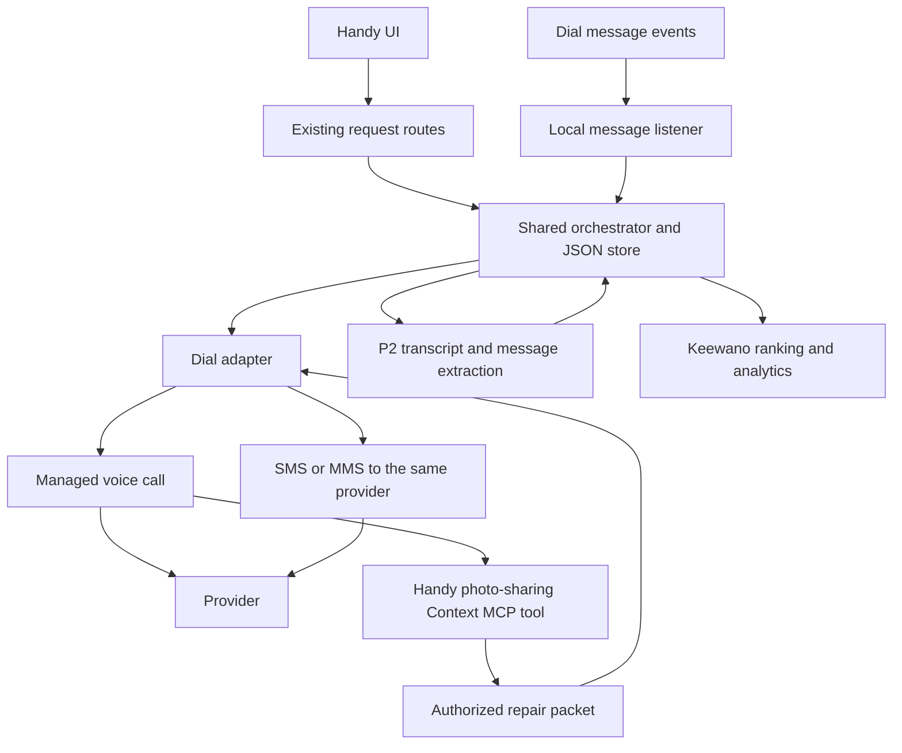

# Handy Dial engineering design

**Status:** Reviewed; implementation started · October 11, 2026

**Scope:** Voice calls plus SMS and image sharing for accurate quotes, followed by user-approved scheduling.

**Baseline:** [PRD](https://github.com/alvinwang922/handy/blob/main/PRD.md), current Next.js scaffold, shared types and team ownership. This revision distinguishes the first implemented packet-sharing slice from the remaining work in section 10. No live message or call is claimed without a controlled acceptance test.

Handy should call a provider, share the relevant repair photos and description, establish that both parties are discussing the same issue, and collect a qualified estimate. The user then approves a provider and terms, supplies time windows, and authorizes a separate scheduling conversation. Photos sent, photos reviewed, scope agreed, and appointment confirmed are separate facts.

## 1. Fit with the existing app

The repository already has a Next.js backend, JSON-file storage, a Dial REST adapter, and a polling orchestrator. The frontend in `public/index.html` still simulates the main interactions. Extend these modules and connect the UI to them.

| User step | App behavior and required work |
| --- | --- |
| Report an issue | Keep photo, description, property/unit, room and urgency. Assessment remains preliminary; emergencies stop outreach. Preserve homeowner and property-manager wording. |
| Get quotes | Rank suitable providers, show the photos and summary being shared, then start quote conversations. Exact addresses and access codes are excluded at this stage. |
| Provider call | Show call progress and a parallel message thread. Allow the agent to send the approved photo packet during the call. |
| Compare | Display actual extracted estimates, pricing conditions, photo-review/scope status, and source conversations. Unknown information stays unknown. |
| Approve and schedule | Keep provider selection and time-window entry. The final booking action explicitly confirms the displayed provider, price conditions and windows before dispatch. |
| Track or reschedule | Show a verified appointment. Rescheduling and marking complete remain PRD requirements; they are not yet implemented in the backend. |

The first **Approve estimate** click may remain a UI selection. The final **Approve and call to schedule** action can persist approval through the existing booking endpoint; a separate approval API is not necessary. A changed quote must be shown again before that final action.

Add visible states for **Photos sent**, **Provider reviewed photos**, **Scope confirmed**, and **More information needed**. A delivered message must never automatically set the last two. A description-only estimate can still appear, clearly provisional; the app must not claim photo-based agreement when the provider has not reviewed the images.

## 2. Architecture and ownership

Use the current single-process Next.js app and JSON store for the controlled local demo. Keep voice progress on the existing three-second polling path. Add messaging storage and a local event listener for SMS. Agent-triggered sending during a call adds a narrow Context MCP endpoint reachable by Dial; the rest of the demo app can stay local.

| Owner | Responsibility |
| --- | --- |
| P1 calls | `lib/dial.ts`, `lib/instructions.ts`, receptionist setup; proposed messaging adapter and narrow photo-sharing tool. |
| P2 AI | Diagnosis and structured extraction in `lib/claude.ts`; extract provider-confirmed scope and quote evidence from calls/messages. |
| P3 frontend | Wire existing routes; show sharing status, quote basis, approval terms and scheduling outcomes. |
| Shared glue | Orchestration, persistence, routes, types and schemas. Coordinate additive changes before implementation. |
| P4 data | Keewano provider ranking, recurring-issue context, registered events and metrics; analytics failures must not break a call. |

Seeded provider records plus Keewano ranking are the current discovery path. Darwin remains a conditional discovery extension, not a requirement for Dial dispatch. Alike carries development decisions and handoffs; no runtime repair integration is required. Preserve the separate Alike development-workflow document.

The earlier SQL/job-worker design is a deployment upgrade, not a prerequisite for the demo. Public or multi-user operation needs authentication, property authorization, transactional persistence and durable processing. The current unauthenticated local app must not be described as providing those protections. Expose only authenticated tool/webhook endpoints if tunneling is used.

## 3. Existing contracts and additive changes

Keep the current routes and return shapes:

| Endpoint | Contract |
| --- | --- |
| `POST /api/requests` | Multipart intake; returns `RepairRequest`. |
| `POST /api/requests/:id/outreach` | Selects ranked providers and starts quoting; returns `RepairRequest`. |
| `GET /api/requests/:id` | Poll every three seconds; refreshes Dial calls, extracts results, advances the queue and returns `RepairRequest`. |
| `POST /api/requests/:id/book` | `{providerId, slots[], accessNote, userActiveSec, consentText?}`; records approval and starts booking. |
| `GET /api/requests/:id/ics` | Calendar export for a confirmed appointment. |

Retain `RepairRequest`, `CallRecord`, `Quote`, `Approval`, `BookingResult` and their current USD fields. Do not introduce competing `/api/repairs` endpoints, replace status names, or silently change dollars to cents. Mirror additive model fields in `lib/schemas.ts`.

Proposed additions, not fields already present:

| Record or extension | Purpose |
| --- | --- |
| `RepairPacket` | Immutable description/assessment version, provider-safe location, requester role and approved represented-party label, selected photo IDs/version, summary, and authorization to share with the outreach providers. |
| `MessageRecord` | Local/Dial IDs, repair/provider/call association, direction, text, media references, delivery state, source, packet version, timestamps and error. |
| `PhotoReview` | `unknown`, `not_received`, `not_reviewed` or `reviewed`; provider's description of the issue, explicit scope agreement and supporting call/message evidence. |
| `CallRecord` additions | Persisted dispatch key/state, frozen prompt/packet, extraction state and evidence references. |
| `Quote` additions | Quote revision and source call/message references; packet version; quote basis (`photos_and_call`, `description_only`, `inspection_required`); review/scope evidence. |
| `Approval` additions | Exact quote revision or snapshot, pricing basis, hourly rate where relevant, authorized total cap or inspection-only fee, waiver conditions, scope, booking type, windows and actor where available. |
| `BookingResult` additions | Structured outcome, agreed scope/price conditions, normalized window and provider-confirmation evidence. |

Add `quoteCallId` and `quoteRevision` to the booking request. The revised UI submits the version it displayed; the backend compares it with the stored quote and rejects stale or missing evidence of approved terms before live booking. Existing stored requests can keep nullable migration fields, but cannot bypass this check. Carry requester role and represented-party label from intake into the packet so homeowner calls do not default to the property-management company persona.

For multiple photos, add a photo collection while preserving the existing `photoPath` as the primary image. Current intake only stores one; do not promise a working gallery without that extension.

A new proposed `POST /api/requests/:id/share-packet` accepts a provider ID and packet version for the UI's **Send photos** action. The server resolves recipient and files from the repair; neither the browser nor the voice model can supply arbitrary phone numbers or media URLs. It calls the same sharing service as the MCP tool. Persist messages on the request response or behind an additive messages endpoint if payload size requires it.

Keep current `slots: string[]` for compatibility, but add canonical start/end timestamps, a display label and the property's IANA timezone. The current calendar exporter guesses a weekday and two-hour duration; replace that behavior before presenting calendar downloads as exact confirmations.

## 4. Quote conversation and scope agreement

1. **Prepare the repair packet.** Snapshot selected photos, the user's observations, preliminary assessment and proposed scope. Separate observations from guesses. Use the property's neighborhood/service area, not the provider's service-area field as though it were the property location.
2. **Select providers.** Keep trade filtering, Keewano ranking, the top-three queue and rating fallback. A provider needs a verified controlled destination for the demo. Filter actual service-area compatibility when real discovery is introduced.
3. **Persist before contact.** Save a queued attempt and immutable prompt/packet before calling Dial. Save its returned call ID immediately. The current orchestrator dispatches before saving; that ordering must change.
4. **Open the call.** Disclose that Handy is an AI assistant acting for the homeowner or manager. Describe the issue, ask whether this is a suitable number for photos, and send the approved packet through the tool in section 6. Pre-sending is allowed when messaging suitability is already known.
5. **Confirm understanding.** Ask whether the provider can open the images and what area/problem they show. Read back the proposed repair scope and ask for agreement or a correction. A voice agent must not infer that the provider saw a photo from a delivery receipt.
6. **Collect the estimate.** Ask total/range versus hourly price, parts/labor inclusions, visit fee and waiver, inspection needs, warranty, exclusions and availability. Replacement options remain separate from the original repair estimate. No hiring, appointment commitment or exact address disclosure occurs in this call.
7. **Extract and publish.** P2 extracts facts from the provider's words and replies, validates the schema, and retains evidence. Show partial results as cards fill. If photos cannot be viewed, record that limitation and qualify the quote; if the provider disputes the issue or needs another image, surface a follow-up rather than invent agreement.

**Dial contract:** the current REST path `POST https://api.getdial.ai/api/v1/calls` and `{call: ...}` response wrapper match the reference. Send `outboundInstruction`, `to`, and exactly one sender selector. Keep `maxCallDurationSeconds` at 240 for quotes and 180 for booking unless configured within account limits; documented values are 60–3600 seconds, with additional free-account restrictions. [Call API](https://docs.getdial.ai/api-reference/rest-api/calls/make-call)

Poll the call after termination until a transcript arrives or a bounded wait expires. The existing 60-second post-termination wait is a Handy policy, not a Dial guarantee. A later **Refresh transcript** can reconcile without redialing. Transcript readiness and extraction success need separate states so an extraction failure can be retried using the saved transcript. [Transcript lifecycle](https://docs.getdial.ai/documentation/capabilities/receive-a-voice-call)

## 5. Approval and scheduling

The existing booking POST is the authorization boundary. Require a usable quote with explicit terms, or an explicitly priced inspection visit. A quote-call record with `quote: null` is insufficient. Hourly pricing with unknown total must be presented as such; an hourly rate is not an approved total cap. Record the rate and an authorized maximum total, or authorize an inspection-only visit with a known fee. Without a clear commitment boundary, seek clarification before booking. A missing repair price is never zero or unlimited consent.

Before dispatch, persist approval, quote/packet snapshot, allowed windows and the queued booking attempt. Validate that the submitted quote revision is still current and serialize booking attempts for the repair. New images that change the issue, revised scope, provider changes or added fees require renewed user review.

The booking agent repeats the approved scope and price conditions, offers only the allowed windows, and shares the address/access details after the provider agrees. Preserve conditional fee waivers; the current formatter's unconditional “plus visit fee” wording must not turn a waived fee into an approved extra charge.

The application marks `scheduled` only when provider evidence confirms an allowed window and unchanged approved terms. P2's extractor needs the approved quote and scope in addition to the transcript and slots. Apply deterministic checks after extraction: nonempty matching slot, consistent provider, current approval and no material changes. A model's `confirmed: true` is not sufficient on its own.

Outcomes: confirmed, no matching window, revised quote requiring approval, clarification needed, or communication failure. An SMS or call that merely proposes a time cannot confirm the appointment. A failed written-summary delivery does not undo an appointment already agreed during the call.

Rescheduling is still required by the PRD but needs explicit implementation. Keep the old appointment while negotiating, require acknowledgment that the new slot replaces it, and surface any cancellation without replacement. Do not silently create a second booking. Completion tracking also needs an explicit app action and status extension.

## 6. SMS and images during calls

**Primary purpose:** let the provider inspect the same issue Handy is discussing and return a quote against that scope. Written quote and appointment summaries are secondary uses. The older team spec's “SMS out of scope” no longer reflects this requested slice; reconcile that statement during team integration.

### Repair packet delivery

Send a short text with the repair reference, room, observed symptoms, preliminary scope, and selected images. Example: “Repair H123: leak at the kitchen sink drain connection; cabinet gets wet after use. Photos attached. Please confirm which connection you see leaking and whether your estimate covers that repair.” Omit access codes, tenant contact details and precise address from quoting messages.

Dial's message API accepts JSON `mediaUrls` or multipart file uploads. Standard-number MMS allows up to ten items with a 5 MB per-file limit, and the REST reference additionally specifies a 5 MB total carrier-content cap. Use at most three compressed JPEG/PNG images comfortably below that total. HEIC and the prototype's SVG sample need conversion or a supported demo fixture. [Send message API](https://docs.getdial.ai/api-reference/rest-api/messages/send-message)

Native MMS delivery is documented for US/Canada; other supported destinations may receive links. Dial mirrors attachments to public, non-expiring media URLs, so expiring an upload source cannot revoke the resulting copy. [SMS and media capabilities](https://docs.getdial.ai/documentation/capabilities/send-an-sms), [Public media API](https://docs.getdial.ai/api-reference/rest-api/messages/get-public-media)

For the controlled demo, use a non-sensitive fixture. For real repair photos, show the selected images before sharing, strip unnecessary metadata, and avoid including unrelated personal details. A Handy-hosted expiring photo page sent as a link in the text body is an alternative where access control matters; do not pass it as `mediaUrls`, which would initiate media ingestion. Build and deploy that page before offering it. A localhost photo URL cannot serve an external provider or Dial.

### Agent-triggered sharing

Use a narrow `send_repair_packet` tool on a Handy Context MCP server. Dial documents that connected tools are available to its managed voice agent during calls. This is a custom Handy tool calling the messaging adapter; putting “text them the photos” in a prompt alone does not establish a working message action. [Context MCP](https://docs.getdial.ai/documentation/platform/context-mcp)

Authenticate the MCP connection and authorize each tool call using `X-Dial-Direction`, `X-Dial-User-Number` and `X-Dial-Agent-Number`. No repair/call ID header is documented. Resolve exactly one active server-side attempt for the pair and direction; reject missing/template values or ambiguous matches. Tool discovery must not return repair data. The model cannot choose a recipient or arbitrary file. The demo provider's inbound call leg cannot access the coordinator's repair-sharing tool.

The service checks that the packet is approved for sharing, records an attempt before sending, and returns the existing message status when the same packet is requested again. Return `pending`, `delivered`, `failed` or `send_unknown` accurately; the voice agent reports only what the result establishes. If a send response is uncertain, do not resend automatically. An intentional resend requires a new reviewed attempt.

A UI **Send photos** button uses the same service and supports manual assistance during a live call. If the provider requests a different recipient, create a follow-up task for the user to verify it; do not redirect home photos solely on an unverified spoken number. If another angle is needed, request it from the user, create a new packet version, and re-confirm the relevant scope.

### Replies and evidence

Store inbound/outbound messages with the call and packet references. `sendMessage` starts a thread; `replyToMessage` can answer a received message. Both sending and replying need application-level duplicate protection. Reconcile uncertain sends with filtered `listMessages`; Dial has no message get-by-ID route. [Reply API](https://docs.getdial.ai/api-reference/rest-api/messages/reply-to-message), [Message event](https://docs.getdial.ai/api-reference/events/message-received)

One active workflow per number pair avoids ambiguous repair references in the MVP. Provider text is untrusted input: it can clarify scope but cannot authorize the homeowner's spending, change the recipient or override system rules. Stop replies after completion, opt-out, or a six-reply budget. Carry actual message source/channel so dashboard-injected traffic is labeled as simulated.

A delivered photo is not proof it was viewed, and standard SMS does not supply read receipts. Record review and scope agreement only from explicit provider statements. The AI receptionist demo can acknowledge a fixed scenario, but do not claim it visually inspected images unless an image-capable tool has actually done so. Use a human teammate for the photo-review acceptance test.

## 7. Reliability and events

**Voice MVP:** preserve REST polling and the existing states `diagnosed → quoting → quotes_ready → booking → scheduled`, with `emergency` and `failed`. Per-call lifecycle remains `queued_local`, `Queued`, `Ringing`, `In-Progress`, `Terminated`. Model sharing/extraction outcomes separately rather than overloading these states.

The current GET refresh drives extraction and queued dispatch. If the browser stops polling, that processing pauses while already placed calls continue at Dial. Keep the demo's progress view open and document this behavior. Moving refresh to a persistent worker is required for unattended processing, not something polling already provides.

**SMS MVP:** run a persistent local event listener and open it before sending. The SDK's stream only replays missed events within two minutes. Store a message watermark and reconcile filtered history after reconnecting. The documented message list returns up to 100 newest records without pagination; hitting that ceiling is a possible recovery gap to surface, not proof of complete recovery. Deduplicate message IDs and serialize updates through the same app process/store owner. A separate listener process forwards events to the app rather than independently writing `data/db.json`. [Node events](https://docs.getdial.ai/documentation/sdks/node), [List messages](https://docs.getdial.ai/api-reference/rest-api/messages/list-messages)

**Hosted upgrade:** signed webhooks can replace the local listener. Verify the signature over the timestamp and exact raw body, check header/body ID and type consistency, persist the event and return `2xx` before Dial's 10-second timeout. Deduplicate verified event IDs, handle `webhook.ping`, and reconcile gaps after the bounded six delivery attempts. [Webhooks](https://docs.getdial.ai/documentation/platform/webhooks)

Normalize REST and event fields: the call resource has structured `status.state` and `duration`; `call.ended` carries a terminal outcome and `durationSeconds`. Retain cancellation information. Follow transcript availability rather than treating a completed transport as a successful quote or booking. [Get call](https://docs.getdial.ai/api-reference/rest-api/calls/get-call), [Call ended event](https://docs.getdial.ai/api-reference/events/call-ended)

The specific REST reference and SDK docs support a call idempotency key, while older tutorial/limits prose says otherwise. Preserve the team's no-automatic-call-retry rule. Add a stored key defensively, reconcile uncertain placement, and validate its behavior on controlled numbers before relying on retry semantics. SMS sends/replies remain non-idempotent. [Retry reference](https://docs.getdial.ai/documentation/reference/errors#retries-and-idempotency)

Required hardening: account-wide dispatch capacity, persistence before side effects, duplicate booking protection, explicit unknown-send states, retryable extraction, bounded backoff for temporary failures, and a paused state for exhausted credit. Current concurrency is per repair, and `402`/`429` are retried on refresh; do not describe that as account-wide budgeting or controlled retry yet.

Keep Keewano's registered event names (`QuoteRequested`, `CallAnswered`, `QuotePriceCents`, `JobBooked`, `UserActiveSec`, etc.). Coordinate additions for packet sent, scope confirmed and messaging failure with P4. The current nonthrowing analytics calls are best-effort; a durable outbox and repair sequence become a deployment improvement, not an already implemented audit trail.

## 8. Demo setup and boundaries

Keep existing `MOCK_DIAL`, `MOCK_CLAUDE`, `MOCK_KEEWANO`, `MAX_CONCURRENT_CALLS`, company name and call-duration configuration. The first packet-sharing slice adds a server-side `DIAL_ALLOWED_RECIPIENTS` check for live messages. MCP authentication and call-context authorization remain to be implemented.

Use Handy number A and a controlled provider number B. The earlier account review found US outbound messaging registration incomplete, so use verified Dial-to-Dial messaging for the initial demo. Calling support alone does not establish photo-message delivery to an ordinary mobile or business line. Verify channel eligibility and delivery with the actual recipient before the demo. [Hackathon quickstart](https://getdial.ai/hackathon/speedhacks/quickstart)

Start with one outbound call; confirm account limits and allow for the provider's inbound leg if both numbers use the same account. A credit promotion is not proof of unlimited concurrency. Keep every API key, number mapping, transcript and private photo out of public GitHub. MCP/webhooks need reachable authenticated endpoints. Uploading local images as multipart avoids exposing their source URL; `mediaUrls` must be reachable by Dial, and a Handy photo page must be reachable by the recipient.

An AI receptionist demonstrates agent-to-agent voice, but a human teammate viewing the delivered image demonstrates the new photo-review requirement. For the Dial-to-Dial test, deliberately configure B to forward inbound voice to a controlled teammate phone; the teammate answers there and views B's received images in Dial. Alternatively, use a verified messaging-eligible human destination. This forwarding setup must be tested; it has not been configured by this design review. [Inbound forwarding](https://docs.getdial.ai/documentation/capabilities/receive-a-voice-call)

Label fictional businesses, sample repair photos, seeded rankings, fixture transcripts and mock extraction independently. Real transport does not make a simulated business or forced mock booking outcome real.

## 9. Implementation sequence and acceptance tests

| Step | Required result |
| --- | --- |
| 1. Align contracts | Adopt this revision's current routes/ownership; agree additive packet, message, approval and booking-evidence fields with teammates. |
| 2. Harden voice and approval | Persist before dispatch, block unusable quotes, separate extraction from call completion, validate approved terms/windows. |
| 3. Deliver photos | One selected repair packet reaches the controlled provider; receipt, review and scope statuses remain distinct. |
| 4. Share during a call | Managed voice invokes the authorized Context MCP tool; the provider receives and discusses the image without the model choosing arbitrary recipients. |
| 5. Complete the journey | Image-backed quote → explicit approval → offered windows → booking call → validated confirmation in the existing UI. |
| 6. Finish PRD gaps | Rescheduling, completion, and reliability upgrades are tracked explicitly; they are not silently claimed complete by the demo. |

Keep P1 transport/prompts in existing files. Add a small shared packet service, message listener and MCP endpoint; do not start a separate general-purpose agent platform. P2 owns extraction updates, and shared route/type/store changes follow team coordination.

Tests must cover REST response mapping; late/missing transcripts; extraction retry without redial; duplicate clicks/tool calls/events; crash after dispatch; account-wide call capacity; credit exhaustion; cross-repair MCP access; missing/ambiguous call headers; unsupported/oversized images; uncertain or failed message delivery; provider has not viewed images; changed scope after new photos; conditional visit fees; missing quotes; out-of-window or higher-price booking responses; and failed rescheduling preserving the old appointment.

**Live acceptance flow:** upload a supported sample image, call a controlled human provider, have the agent send it during the conversation, hear the provider identify the issue and agree the quoted scope, show that evidence with the estimate, obtain user approval/windows, and confirm a second scheduling call against the approved terms. A delivery receipt or mock extractor must not substitute for provider agreement.

Measure usable-quote time, photo-review/scope-confirmation rate, clarification requests, user active time and approved-booking completion. The PRD's 50% time-saving target is still a hypothesis, not a measured outcome.

## 10. Current implementation

The first backend slice now supports one reviewed JPEG or PNG photo, capped at 1 MB, for a provider already included in the repair's quote outreach. It omits the property address and access note, versions the packet from its contents, requires an idempotency key, records the attempt before contacting Dial, and does not retry an uncertain send. Live messages require both Dial credentials and an exact recipient allowlist match. Mock mode performs no network request.

| Endpoint | Current behavior |
| --- | --- |
| `GET /api/requests/:id/packet?providerId=:providerId` | Builds a provider-safe preview, warnings and an immutable packet version. |
| `POST /api/requests/:id/share-packet` | Sends the reviewed packet through the mock or Dial REST adapter. Requires `Idempotency-Key`, `providerId` and `packetVersion`. |
| `GET /api/requests/:id/messages` | Returns packet-send history with dispatch, delivery and photo-review states kept separate. Internal deduplication fingerprints are omitted. |

Automated tests cover safe packet content, changed versions, emergency blocking, concurrent duplicate requests, uncertain delivery, idempotency conflicts and retries, and mock transport isolation. The API flow has also been exercised locally in mock mode. Production build and static checks pass.

The UI action, Context MCP tool, inbound message/event listener, delivery reconciliation, provider photo-review evidence, image metadata removal/compression, multi-image selection, and controlled live acceptance test remain in the next slices. Until those exist, the feature must not imply that a delivered image was reviewed or that a live provider confirmed the scope.

## Section review outcome

| Section | Review result |
| --- | --- |
| 1 | Corrected the outdated static-only description; preserved homeowner/manager flow and added photo-review visibility. |
| 2 | Reused Next.js/polling; corrected ownership and sponsor boundaries; added the supported mid-call tool path. |
| 3 | Preserved existing API/types; specified additive packet, message, evidence and scheduling fields. |
| 4 | Added photo-based scope agreement and corrected location, quote terms, persistence and transcript handling. |
| 5 | Closed design gaps around missing quotes, approval persistence, changed fees, confirmed windows and rescheduling. |
| 6 | Made image sharing during quote calls a core requirement; separated MMS transport, review evidence and tool authorization. |
| 7 | Distinguished local-demo behavior from durable delivery; documented retry conflicts and current implementation gaps. |
| 8 | Kept controlled destinations and truthful demo labels; added a human photo-review test. |
| 9 | Reordered work around the current app and the newly clarified image-sharing journey. |
